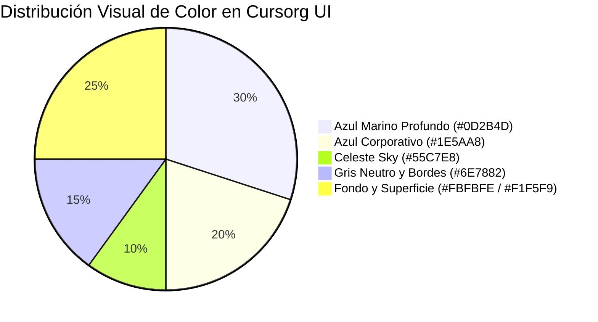
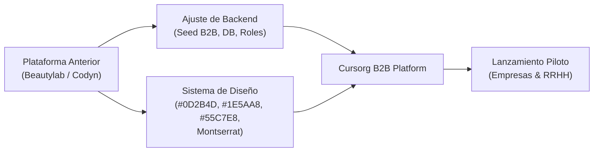

# Dossier Estratégico y de Marca: Cursorg (CURSORG)

Este documento condensa la totalidad de los requerimientos, análisis de mercado, identidad de marca y especificaciones funcionales recopiladas a partir de la documentación oficial en `CursorgDocxPptxPdf/`.

---

## 1. Identidad de Marca y Sistema Visual

### 1.1 Nombre y Posicionamiento
* **Nombre de Marca:** **Cursorg** (estilizado en altas **CURSORG** en el wordmark/logotipo tipográfico institucional).
* **Eslogan Principal:** *"Capacitación corporativa sin barreras."*
* **Lemas de Apoyo:**
  * *"Tu equipo crece con evidencia."*
  * *"Formación que habla tu idioma y opera en tu moneda."*
  * *"Tu equipo crece donde quiera que esté."*
* **Tono de Voz:** Profesional, sobrio, cordial, empático y orientado a resultados de negocio tangibles.
* **Canal Oficial:** Instagram `@cursorg.ve`.

### 1.2 Paleta de Colores Corporativos

| Rol | Nombre | HEX | RGB | Aplicación en la Plataforma |
| :--- | :--- | :--- | :--- | :--- |
| **Primario** | **Azul Marino Profundo** | `#0D2B4D` | `13, 43, 77` | Barra de navegación superior, sidebar administrativo, encabezados H1/H2, pie de página institucional. |
| **Secundario** | **Azul Corporativo** | `#1E5AA8` | `30, 90, 168` | Botones de acción principales (CTAs), enlaces activos, estados hover interactivos. |
| **Acento** | **Celeste / Sky** | `#55C7E8` | `85, 199, 232` | Isotipo, insignias (*badges*), barras de progreso, acentos destacados. |
| **Neutro / Apoyo** | **Gris Neutro** | `#6E7882` | `110, 120, 130` | Textos secundarios, descripciones, bordes de tarjetas y divisores. |
| **Fondo** | **Blanco Hielo** | `#FBFBFE` | `251, 251, 254` | Fondo general de la aplicación web. |
| **Superficie** | **Gris Claro / Slate** | `#F1F5F9` | `241, 245, 249` | Fondo de tarjetas, paneles y contenedores. |

### 1.3 Tipografía y Diseño de Interfaz
* **Tipografía Primaria:** **Montserrat** (Google Fonts).
* **Iconografía:** Iconos lineales limpios y geométricos (*Lucide Icons*).
* **Estilo de Contenedores:** Bordes suaves con esquinas redondeadas (`rounded-xl` / `rounded-2xl`).
* **Estilo Visual Fotográfico:** Fotografías reales de trabajadores y entornos de oficina e industria en Latinoamérica.

---

## 2. Visión del Proyecto y Objetivos SMART

### 2.1 Problema que Resuelve
1. **Fricción Cambiaria e Impositiva:** Las plataformas internacionales (Udemy, Coursera, LinkedIn Learning) exigen tarjetas de crédito corporativas en divisas, tienen altos costos en dólares y generan complicaciones contables/fiscales.
2. **Contenidos Poco Adaptados:** Cursos anglocéntricos o teóricos que no atienden la legislación laboral, seguridad industrial y dinámicas operativas de la región.
3. **Alternativas Tradicionales Costosas:** Firmas consultoras locales con modelos presenciales lentos, caros y sin trazabilidad digital.

### 2.2 Misión y Visión
* **Misión:** Brindar a las empresas latinoamericanas una plataforma tecnológica accesible, segura y especializada para la capacitación continua de sus colaboradores, con soporte personalizado en español, pagos en moneda local y certificaciones verificables.
* **Visión (2029):** Consolidar más de **100 empresas B2B activas** y capacitar recurrentemente a más de **5.000 empleados**.

### 2.3 Objetivos SMART
* **Meta 1 (Adopción Piloto):** Captar **5 empresas piloto** en sectores clave (industrial, comercial, servicios) con un total mínimo de **100 empleados activos** antes del 30 de noviembre de 2026.
* **Meta 2 (Tasa de Finalización):** Garantizar un índice de finalización igual o superior al **80%** en los cursos asignados dentro de los primeros 30 días.
* **Meta 3 (Comunidad y Demanda Inbound):** Desarrollar la presencia digital en `@cursorg.ve` y generar **20 contactos empresariales calificados (leads B2B)** antes del 23 de diciembre de 2026.

---

## 3. Modelo de Negocio y Lienzo de Emociones

### 3.1 Clientes Objetivo (B2B)
* Medianas empresas y PyMEs (de 20 a 500 colaboradores).
* **Sectores prioritarios:**
  1. *Industrial & Manufactura:* Seguridad y salud laboral, mantenimiento y operación.
  2. *Comercio & Retail:* Ventas consultivas, atención al cliente, operaciones de tienda.
  3. *Servicios Financieros:* Cumplimiento normativo, prevención de fraudes y finanzas prácticas.

### 3.2 Lienzo de Emociones (Customer Emotion Canvas)
* **Confianza:** Reflejada en la paleta azul institucional, contratos claros y facturación en moneda nacional.
* **Tranquilidad:** RRHH y operaciones reducen el estrés de control manual y reportes de cumplimiento.
* **Orgullo Profesional:** Colaboradores obtienen certificados digitales verificables con código único y QR.
* **Progreso Colectivo:** La empresa visualiza la rentabilidad y evolución del talento humano.

---

## 4. Estructura de Cursos Piloto (MVP)
1. **Seguridad y Salud en el Trabajo / Prevención de Riesgos Industriales.**
2. **Finanzas Prácticas para No Financieros y Gestión Presupuestaria.**
3. **Técnicas Modernas de Ventas Consultivas y Excelencia en Atención al Cliente.**
4. **Habilidades Digitales y Productividad Corporativa en la Oficina Moderna.**
5. **Liderazgo Operativo y Supervisión Efectiva de Equipos.**

---

## 5. Plan de Transición: De Beautylab / Codyn a Cursorg

1. **Reemplazo de Identidad y Paleta en Frontend:**
   - Cambiar fuentes a `Montserrat`.
   - Modificar las variables de color primarias y secundarias a `#0D2B4D`, `#1E5AA8`, `#55C7E8`, `#6E7882`.
   - Modificar logotipo, isotipo y textos en la barra de navegación y pie de página.
2. **Transformación del Contenido y Hero:**
   - H1 corporativo enfocado en talento empresarial y capacitación continua.
   - Llamados a la acción para solicitud de demostración institucional (*B2B Demo Request*).
   - Métricas de impacto: Pago en moneda local, onboarding <48h y 80%+ tasa de finalización.
3. **Reconfiguración del Seed de Datos en Backend:**
   - Reemplazar cursos cosméticos/programación por los 5 cursos corporativos de Cursorg.
   - Ajustar empresa institucional en configuración de correo y facturación a Cursorg.
